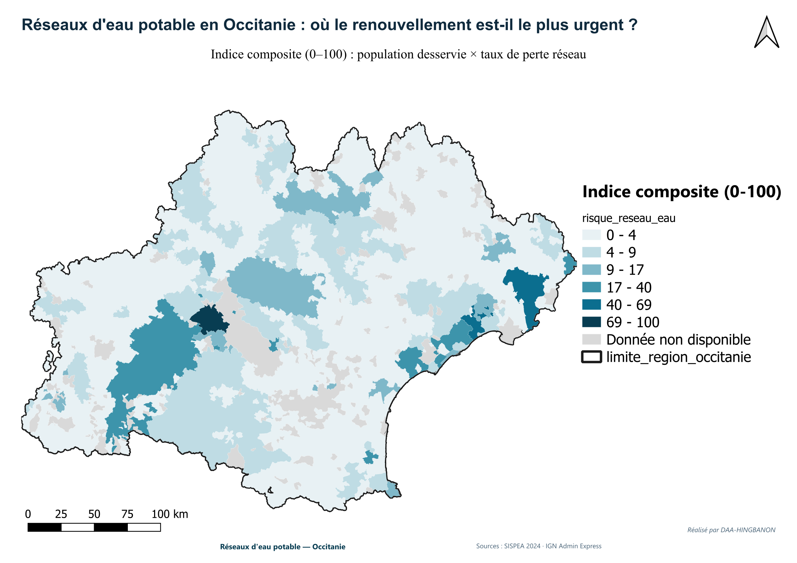
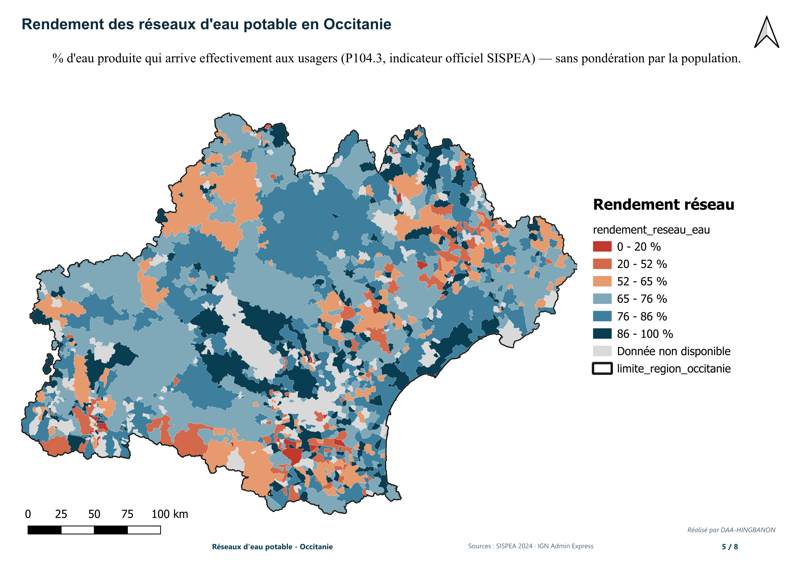
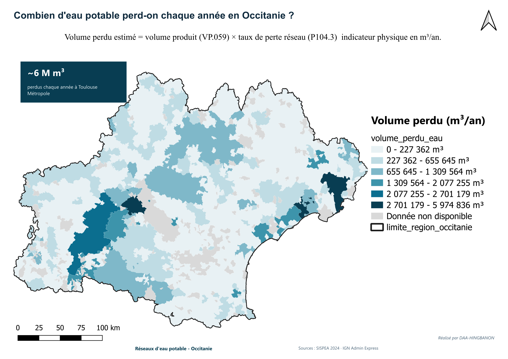
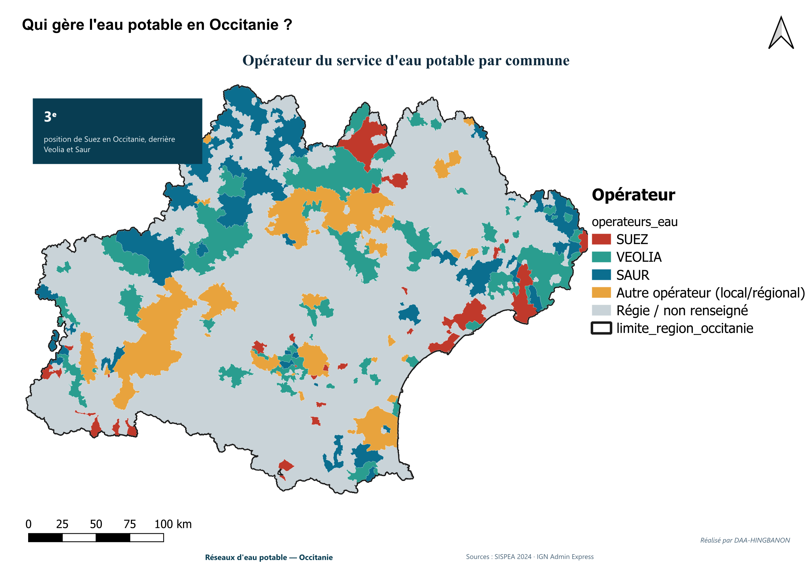

# Eau potable en Occitanie : lecture cartographique des pertes réseau par commune

Analyse en données ouvertes de la performance des services d'eau potable en Occitanie, croisant les indicateurs SISPEA 2024 avec le découpage communal de l'IGN.

**Carte interactive : https://jauresmas.github.io/Occitanie_Eau_SIG/**

Quatre lectures sont disponibles dans la carte : indice de risque réseau, rendement, volume perdu et opérateur du service. Le survol d'une commune affiche sa valeur, un clic ouvre le détail.

## Cartes

### Où le renouvellement du réseau est-il le plus urgent ?
Indice composite de 0 à 100 : population desservie multipliée par le taux de perte du réseau.

### Rendement des réseaux
Part de l'eau produite qui arrive effectivement aux usagers (indicateur P104.3 de SISPEA), sans pondération par la population.

### Combien d'eau potable est perdue chaque année ?
Volume perdu estimé en m³ par an : volume produit (VP.059) multiplié par le taux de perte du réseau (P104.3).

### Qui gère l'eau potable ?
Opérateur du service d'eau potable par commune.

## Ce que démontre le projet

- Chaîne complète en données ouvertes : récupération, nettoyage, jointure, analyse
- Base PostGIS (communes, indicateurs SISPEA, vue de jointure)
- Cartographie QGIS avec mises en page : titre, légende, échelle, sources
- Carte web interactive autonome (Leaflet), publiée avec GitHub Pages

## Contenu du dépôt

| Dossier | Rôle |
|---|---|
| `docs/index.html` | Carte web interactive, données incluses dans le fichier |
| `exports/` | Cartes exportées depuis QGIS (versions `pro/` en mise en page finale) |

Les données volumineuses (GeoPackage, GeoJSON) ne sont pas versionnées. Elles se reconstituent à partir des sources ci-dessous.

## Sources

- SISPEA 2024 : indicateurs de performance des services d'eau et d'assainissement
- IGN Géoplateforme : limites communales ADMIN EXPRESS (service WFS)

Projection de travail : Lambert-93 (EPSG:2154).

Outils : QGIS, PostgreSQL / PostGIS, Leaflet.
